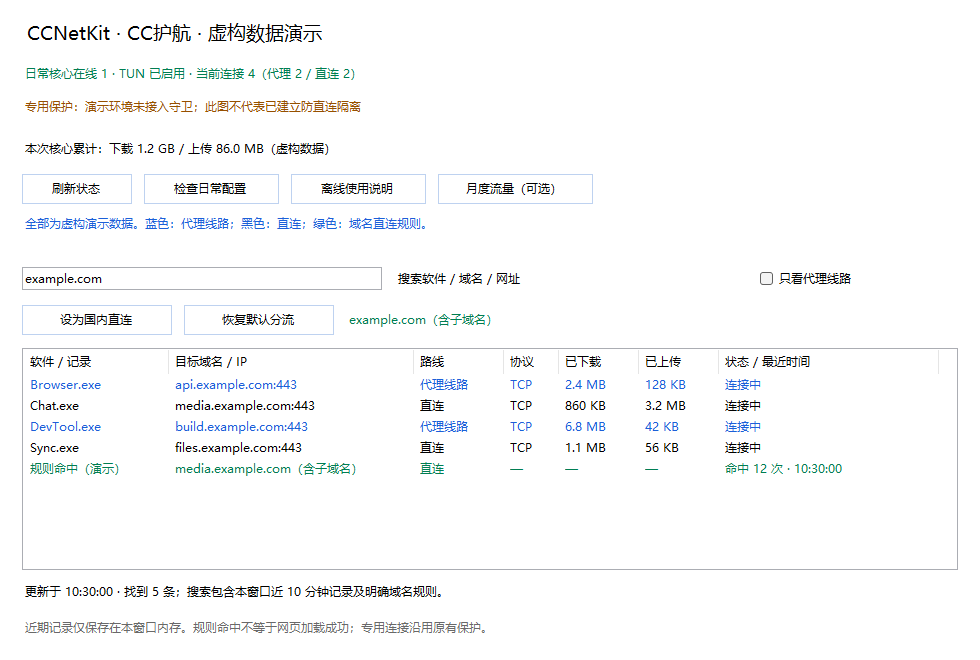

# CCNetKit · CC护航

**Claude Code 专用网络适配助手。** 使用你自己的 VPS、兼容订阅或代理服务，为 Claude Code 配置专用线路，同时保留原有日常网络和网站中转。

同一个 skill 自动识别 Windows 和 Mac，私人节点与配置只保存在本机。国内直连、海外代理、连接查询、网站规则和其他软件分流是配套功能；Windows 与 Mac 的保护能力差异见下文。

## 怎么使用

打开 [最新发布页](https://github.com/luckyyy852/CCNetKit/releases/latest)，在 Assets 中下载 `ccnetkit-v版本号.zip`（不是 Source code）。解压后保留整个 `ccnetkit` 文件夹，里面应直接看到 `SKILL.md`。放入对应工具的个人技能目录：

| AI 工具 | 文件夹放到哪里 | 如何调用 |
| --- | --- | --- |
| Codex | `~/.agents/skills/ccnetkit/` | `$ccnetkit` |
| Claude Code 本机版 | `~/.claude/skills/ccnetkit/` | `/ccnetkit` |

旧版已安装的技能和管理界面仍可使用；更新技能时改用 `ccnetkit` 目录和调用名，原管理界面与网络配置无需迁移。

`~` 是当前用户主目录；找不到目录或工具不识别时，让 AI 按它的实际版本检查，也可直接告诉 AI 解压位置，让它读取该文件夹的 `SKILL.md`。仅上传到网页聊天或云端会话，不能自动配置你的本机网络。[Codex 官方说明](https://developers.openai.com/codex/skills/) / [Claude Code 官方说明](https://code.claude.com/docs/en/skills)。

下面的指令可直接发给 Codex；Claude Code 使用上表中的 `/ccnetkit` 调用，再说明相同目标：

```text
使用 $ccnetkit，识别我的系统，使用我自己的节点为 Claude Code 配置专用网络并安装管理界面，保留已有保护、日常分流和网站中转，不上传私人配置。
```

解压后，让能操作本机的 AI 读取 `SKILL.md`。AI 会自动识别系统、检查已有网络，并识别你提供的节点链接、订阅或本地配置；缺少参数时再询问，随后完成安装和连接验证。节点和密钥保存在本机私人文件中。

需要提供资料时，按手里已有的内容选择：

- **已有代理客户端：**告诉 AI 客户端名称，先检查能否复用；如果读取不到，AI 会说明如何导出节点。
- **有节点链接或订阅：**保存到本机私人文本文件，告诉 AI 文件路径，由它读取并识别格式。
- **只有服务商提供的参数：**将原参数保存到本机私人文件，告诉 AI 路径；AI 识别后只问缺项，并说明去哪里找、如何提供。

私人文件放在技能文件夹之外，不贴到公开 issue。只有 VPS 或 IP 地址时，还需要先部署代理服务，才能取得节点信息。没有现成客户端时，skill 也会按需安装配置 Mihomo；支持自建 VPS 节点、兼容订阅、SOCKS5 和 HTTP / HTTPS 代理。

这是供 AI 编程工具执行的技能和源码包，需要本机配置，不是双击就能完成全部部署的安装器。

完成后，AI 应告诉你从哪里打开、是否已联网、是否开机自动连接，以及出问题时如何恢复；安装了管理窗口不等于已经完成 Claude Code 接入。

**配置 Claude Code 专用网络前，请自行准备尽可能干净、稳定的代理出口 IP，尽量避免有滥用记录或大量共享的出口。** 本工具负责分流与连接保护，不能改善 IP 信誉，也不保证免除平台验证。

网络保护不等于项目文件访问隔离；若要阻止 Claude Code 读取 `.env` 或密钥文件，还需单独配置读取权限。

## Windows 和 Mac

| 系统 | 管理界面 | 环境要求 |
| --- | --- | --- |
| 64 位 Windows 10/11 | 桌面窗口 | PowerShell 5.1、.NET Framework 4.x 编译器 |
| macOS | 本机浏览器界面 | Python 3.10 或更新版本、现有浏览器 |

安装管理界面本身不切换网络，不启动代理，不改开机设置。已有代理优先复用，避免同时开启两个 TUN；需要接管网络时由 skill 按当前环境配置。

工作台的域名按钮需要接入 Mihomo 的持久 JSON 配置，不能直接管理任意 VPN。AI 会先检查兼容性；不能安全接入时保留原客户端，说明限制，不强行替换正常网络。

Mac 支持安装、连接查询、搜索、域名直连和恢复默认功能，已在 macOS CI 验证安装与本地界面；真实节点接入仍需在使用者机器上验证。月度用量和附带的专用核心守卫仅 Windows 提供。Mac 严格防直连需要另行接入并验证系统出站隔离，不能仅靠代理设置保证。

## 平时怎么用

在搜索框输入软件名、域名或网址，查看当前及近期连接：**蓝色代表代理，黑色代表直连**。输入网站后，可点“设为国内直连”或“恢复默认分流”；恢复默认只移除本工具添加的规则，保留原有例外和中转。

Claude 的登录跳转、图片、附件等相关路线由 skill 一并配置和检查。普通浏览器即可使用；需要时使用独立浏览器窗口和指定代理，已有指纹浏览器也可接入，无需额外安装。独立代理窗口里打开的其他网站同样会走该入口。

考虑到中国用户使用 Grok Bot 云端电脑时需要访问国内外网站，提供 Grok Bot 专用分流设置。如需让云端流量使用本机线路，请先在 Bot 中开启“经此电脑转发流量”，并允许云端电脑出站；接入后才会按配置好的规则自动分流，其他软件继续沿用原规则。

开关显示“已启用但尚未转发”时，表示仍在等待云端接入，并未开始转发。这个开关需要用户在 Bot 中开启，skill 不会自动打开。

## 界面示例



这是 Windows 界面的虚构数据演示，Mac 使用本地网页界面。详细操作见 [使用说明](references/user-guide.md)；手动配置见 [Windows](references/mihomo-setup.md) / [Mac](references/macos.md)。

源码采用 MIT 许可。Mihomo 和第三方客户端遵循各自许可。本项目不是相关服务商的官方产品。
